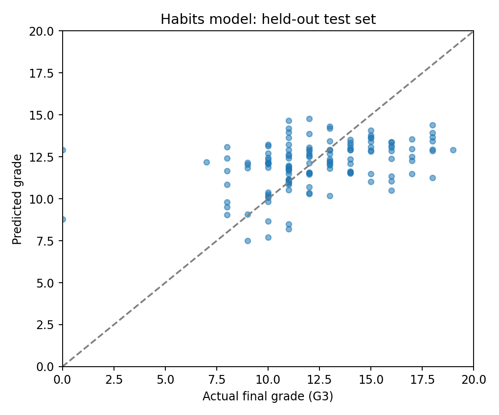
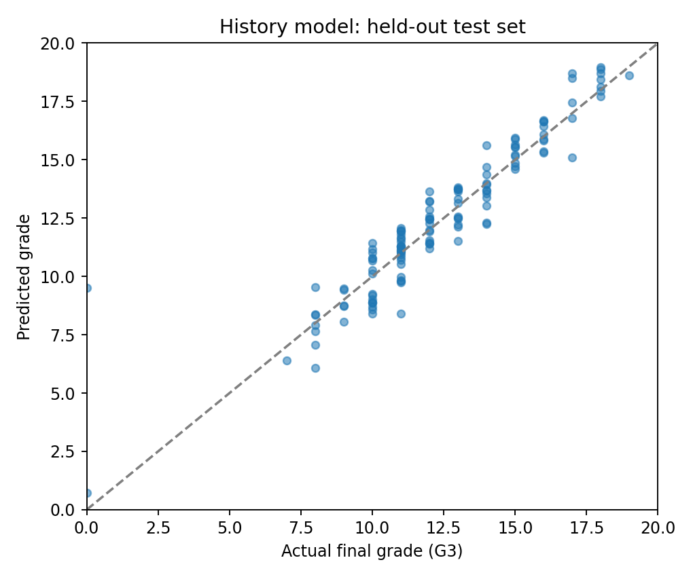
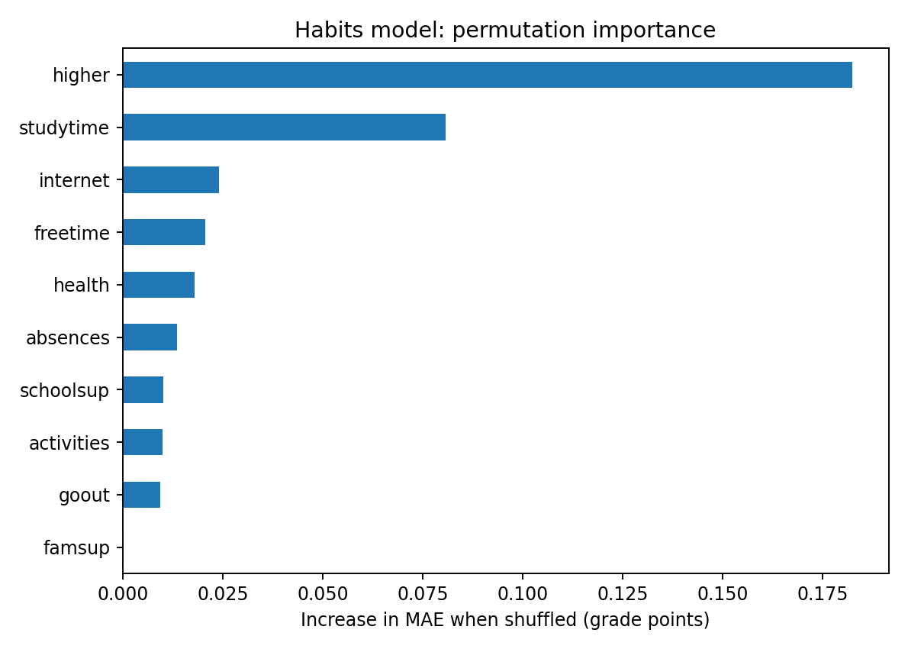
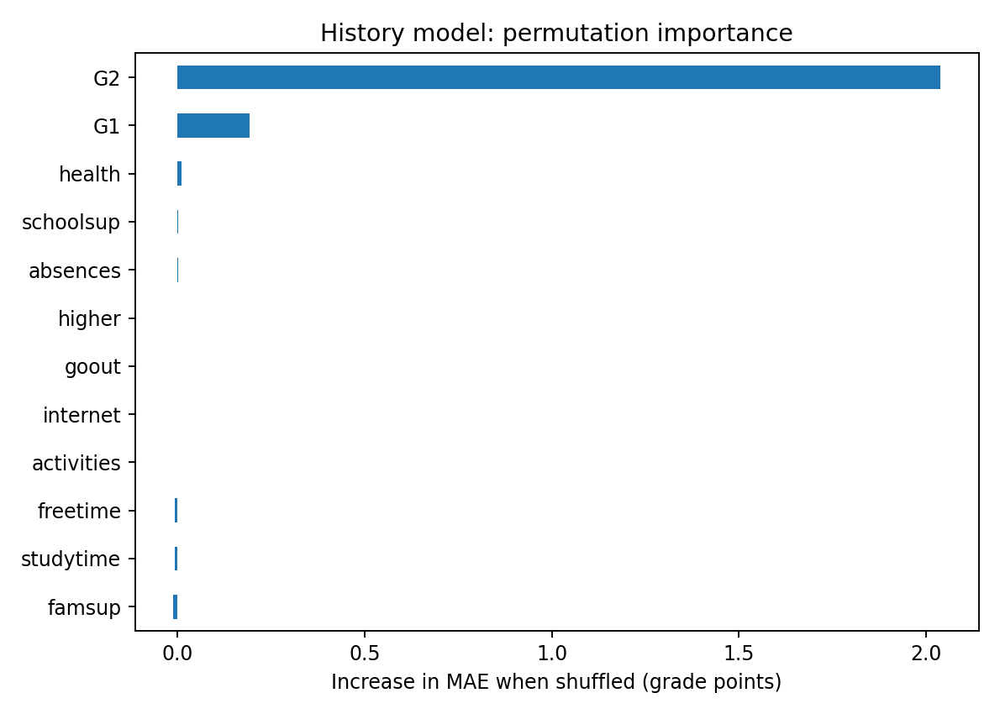

# StudySmart AI

**Predicting Student Academic Performance Using Machine Learning**

An independent machine learning project investigating the relationship between student habits, educational circumstances, previous academic performance, and final examination results.

StudySmart AI uses real-world student data to train predictive models, compare their performance, and provide an interactive web application for exploring predictions.

**[Live Application](https://studysmart-ai-ffzoixi4qfqmteuxsyktmk.streamlit.app)** | **[Research Report](research_report.pdf)** | **[Dataset Source](https://archive.ics.uci.edu/dataset/320/student+performance)**

---

## 1. Project Overview

Academic performance is influenced by a combination of educational, behavioural, and environmental factors. This project explores whether machine learning algorithms can identify patterns within these factors and use them to predict students' final grades.

The research focuses on two questions:

1. How accurately can academic performance be predicted using study habits and other student characteristics?
2. How much does including previous academic performance improve prediction accuracy?

To investigate these questions, two predictive models were developed and evaluated using the same dataset and held-out test records.

## 2. Dataset

The project uses the **Student Performance Dataset** from the UCI Machine Learning Repository, originally collected from Portuguese secondary schools.

| Dataset characteristic | Description |
|---|---|
| Source | UCI Machine Learning Repository |
| Course | Portuguese language |
| Student records | 649 |
| Target variable | Final grade (G3) |
| Grading scale | 0–20 |
| Training records | 519 |
| Testing records | 130 |

The dataset includes information about students' study habits, school absences, extracurricular activities, educational support, and previous grades.

It does not contain direct measurements of sleep duration or recreational screen time.

## 3. Methodology

The project was developed using Python and the Scikit-learn machine learning library.

The dataset was divided into training and testing subsets, with 80% used for training and 20% reserved for evaluation.

Two feature configurations were investigated.

**Model A — Habits and Student Characteristics**

Uses variables such as study time, absences, free time, social activities, extracurricular participation, and educational support.

**Model B — Habits and Previous Grades**

Uses the same variables as Model A, with the addition of previous academic grades (G1 and G2).

Regression algorithms were compared to evaluate their ability to predict the final grade.

Model performance was assessed using:

- Mean Absolute Error (MAE)
- Root Mean Squared Error (RMSE)
- Coefficient of Determination (R²)

## 4. Experimental Results

The evaluated models produced the following results on the held-out test set.

| Evaluation metric | Habits only | Habits + previous grades |
|---|---:|---:|
| Selected algorithm | Ridge Regression | Ridge Regression |
| MAE | 2.16 | 0.75 |
| RMSE | 2.87 | 1.18 |
| R² | 0.153 | 0.857 |

*MAE and RMSE are expressed in grade points on the 0–20 scale.*

The model incorporating previous academic grades achieved substantially higher predictive accuracy than the model using habits and student characteristics alone.

This suggests that prior academic performance contains important predictive information within the dataset.

However, the results do not establish causal relationships between individual student habits and examination outcomes.

## 5. Data Visualisation

The project includes graphical analyses of model predictions and feature importance.

### Predicted vs Actual Grades

The following visualisations compare predicted examination results with students' actual final grades.

**Habits-only model**



**Model including previous grades**



### Feature Importance

Feature-importance analyses provide insight into which variables contribute most to model predictions.

**Habits-only model**



**Model including previous grades**



Feature importance describes predictive relationships within the trained model, not the causal effects of changing individual behaviours.

## 6. Interactive Web Application

StudySmart AI includes an interactive application developed using Streamlit.

Users can:

- Enter student characteristics using sliders and selection menus.
- Switch between the habits-only and academic-history models.
- Generate predicted final examination grades.
- Explore how different input values affect model predictions.

**Access the application:**

https://studysmart-ai-ffzoixi4qfqmteuxsyktmk.streamlit.app

The application is intended for educational research and demonstration. Its predictions should not be used to make consequential decisions about individual students.

## 7. Technologies Used

| Technology | Purpose |
|---|---|
| Python | Programming and data analysis |
| Pandas | Dataset processing |
| NumPy | Numerical operations |
| Scikit-learn | Model training and evaluation |
| Matplotlib | Data visualisation |
| Streamlit | Interactive web application |
| GitHub | Version control and project publication |

## 8. Running the Project

Clone the repository:

```bash
git clone https://github.com/omarsns1/StudySmart-AI.git
cd StudySmart-AI
```

Install the required dependencies:

```bash
pip install -r requirements.txt
```

To reproduce the model training:

```bash
python train.py --data data/student-por.csv
```

Launch the interactive application:

```bash
streamlit run app.py
```

The application will open in a local browser window.

## 9. Limitations

Several limitations should be considered when interpreting the results.

**Dataset size and representativeness**

The dataset contains 649 Portuguese-language course records from two schools in Portugal. The findings may not generalise to students in different educational systems.

**Historical data**

The dataset originates from research published in 2008 and may not reflect contemporary student behaviour.

**Missing variables**

Sleep duration, recreational screen time, and attendance percentages are not directly recorded.

**Correlation versus causation**

Machine learning models can identify statistical associations but cannot establish that changing a particular habit will cause an improvement in grades.

**Predictive reliability**

The models were evaluated on a held-out test subset of the available data. Further external validation would be necessary before applying them to other student populations.

## 10. Future Development

Potential extensions include:

- Collecting an original, anonymous student dataset with appropriate consent.
- Investigating sleep duration and recreational screen time.
- Evaluating model performance across different student populations.
- Comparing additional machine learning algorithms.
- Improving prediction interpretability and uncertainty estimates.
- Expanding the interactive research dashboard.

## 11. Research Report

A research report documenting the methodology, experimental results, visualisations, and limitations is available here:

**[Read the Research Report (PDF)](research_report.pdf)**

## 12. References

Cortez, P., & Silva, A. (2008). *Using Data Mining to Predict Secondary School Student Performance.* Proceedings of the 5th Future Business Technology Conference (FUBUTEC).

UCI Machine Learning Repository. Student Performance Dataset.

https://archive.ics.uci.edu/dataset/320/student+performance

---

**StudySmart AI — Independent Machine Learning Project, 2026**
